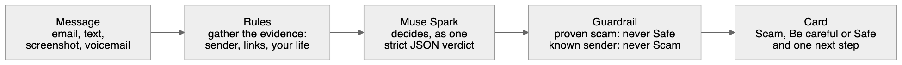

# Prudence

*Ask twice.* (Working title until Oct 28, 2026: Scam Shield. Code, database and repository names still say `scam-shield` until after the hackathon.)
[](https://github.com/hadrienbaradel/scam-shield/actions/workflows/ci.yml) [](https://codespaces.new/hadrienbaradel/scam-shield?quickstart=1) [](_product/docs/testing.md) [](tests/) [](testcases/cases.json) [](LICENSE)

**Senior-first scam protection that judges each message against the user's own life: their real orders, bank, carrier, known breaches and the people they write to.** Built for the [Meta Global AI Developer Hackathon](https://dev.meta.ai) (Oct 26 – Nov 4, 2026, Indie track, "Build for Your World"). Team: Hadrien (product) and Vlad (CTO). Features and where each one stands: [_product/spec.md](_product/spec.md). The original PRD and the first status notes stay in [docs/archive/](docs/archive/) for history. What was built during the hackathon, with times: [docs/PROVENANCE.md](docs/PROVENANCE.md).

Americans 60+ reported **$7.7 billion** lost to online fraud in 2025 (FBI IC3). Gmail already blocks most phishing in bulk. What it does not do is explain, in words a frightened 74-year-old can act on at 9pm, *why* a message is dangerous and *what to do instead*, or check it against *her* life ("your parcel comes by Amazon Logistics, not Chronopost").

## What it does

- **Connects to the user's Gmail** (Google sign-in) and checks every new inbox message within seconds (Gmail push via Pub/Sub, with polling as a backup).
- **Learns a personal context from their own genuine mail**: providers and the addresses they really write from, recent orders and carriers, subscriptions, the people they write to. Data breaches can be ticked in settings, or looked up via HIBP. Every item can be seen and removed.
- **Judges with Meta's Muse Spark** (`muse-spark-1.3`, Standard mode only, so nothing trains Meta's models). A deterministic detector gathers the evidence, is the fallback when the API is unavailable, and acts as a two-way guardrail: the model can neither clear a proven scam nor condemn an authenticated sender the user knows.
- **Acts, reversibly.** Suspicious mail gets a "Prudence/Check first" label. Scams get "Prudence/Scam" and are moved out of the inbox if the user chose that. **It never sends, never trashes, never deletes**, and authenticated mail from someone the user knows is never moved. **Put it back** undoes any move and teaches the sender.
- **Ask my trusted person.** One tap shows a guardian exactly what the senior chose to share. The guardian answers *Scam / Real / I'll call you* by email link or on their dashboard, and the answer appears live on the senior's screen.
- **Checks anything else**: pasted text messages and WhatsApps, and screenshots or photos (read by Muse Spark, never stored).
- **Android companion** ([android/](android/)) screens incoming texts on the phone and sends only risky ones for a verdict. Every tagged release ships its APK, a debug build: [latest release](https://github.com/hadrienbaradel/scam-shield/releases/latest).
- **Threat feed**: daily IC3 and cybermalveillance.gouv.fr alerts become *candidate* pattern cards. They can only reach "active" after human review in the admin console (`/admin/`, Google accounts listed in `ADMIN_EMAILS`), which also shows the health of every dependency, every background job with its runs, and every user's sync state.
- **Live link checks** that never tip off a scammer: domain age from RDAP without visiting the link, and redirects followed only on request or for URL shorteners, with an SSRF guard. A lookup of known malware and phishing sites in abuse.ch URLhaus (host name only) is built but waits for a working `ABUSECH_AUTH_KEY`.
- Built for 60+: 19px+ type with a three-step size setting, 64px buttons, read aloud, EN/FR, one decision per screen.

## Built to be trusted

Every message, whatever the channel, goes through the same steps (the full flow with file paths: [docs/ARCHITECTURE.md](docs/ARCHITECTURE.md)):



<!-- numbers:start -->
| What | Measured |
|---|---|
| Tests (`make check`, the Postgres suites included) | **459 passing**, 0 failing |
| Line coverage of `lib/` and `src/` | **94.77%**; `make check` and CI fail below 93% |
| Seed cases, PRD pass criteria (`make score`, run by CI) | **37/37**, 0 genuine messages called Scam |
| Android companion unit tests (JVM, run by CI) | **64** |
| Commits since the kickoff (Oct 26, 12:24 PM ET), a team of two | **277** in 9 days |
| CI runs (`ci.yml` on GitHub Actions) | **0 failed** of the last 100 (52 passed, 47 cancelled by a newer push, 1 running) |
| Median time to a verdict with Muse Spark (prompt v4, Oct 31) | **5.8 s** per email on 500 public emails; 6.0 s on all 18,849 |

As of 2026-11-04, measured by `make readme-numbers` (a row that names its own date comes from that run); `make check` fails when the coverage here and the run's differ by more than one point.
<!-- numbers:end -->

**Accuracy** on the seed cases, public emails and a real inbox. These are recorded runs that CI does not repeat (Muse Spark calls are paid, and the corpora and the mail never enter the repository); details and sources: [docs/ARCHITECTURE.md](docs/ARCHITECTURE.md), Testing and evaluation.

| Run (date) | Rules alone | With Muse Spark |
|---|---|---|
| The 37 seed cases, PRD pass criteria (Nov 4; every call paid, none fell back to the rules; [raw output](_product/research/open-weights/run-2026-11-04-api.txt)) | 37/37 | **37/37**, 0 false Scam, median 8.5 s |
| 500 held-back public emails, Zenodo 8339691 (Oct 31): phishing called Scam | 32.0% | **79.2%** |
| The same 500: genuine emails called Scam | 1 of 250 | **0 of 250** |
| All 18,849 held-back public emails (Oct 31; Contributor tier, public data only): phishing called Scam | 28.7% | **81.4%** |
| The same 18,849: genuine emails called Scam | 44 of 17,291 | **1 of 17,291** |
| Hadrien's own Gmail inbox, 470 emails (Nov 3) | 40 judged while Muse was unreachable: 2 genuine called Scam, labeled, not moved | **430 judged, 0 called Scam** |

**Meta models in the product.** Muse Spark and Muse Voice Transcribe are called from the server through the Meta Model API (`api.meta.ai/v1`), Prompt Guard through Groq or Hugging Face, Muse Spark Open through Baseten; nothing runs in the browser, and personal numbers are masked before a message leaves.

| Model | What it does in Prudence | Where in the code |
|---|---|---|
| Muse Spark 1.3 (`muse-spark-1.3`, Standard mode) | Judges every message (email, text, voicemail transcript, picture) against the person's own context and the rules' evidence; answers in a fixed JSON schema (verdict, confidence, headline, reasons with the evidence each rests on, what to do) | `checkMessage` in `lib/muse.js` |
| Muse Spark 1.3, vision | Reads screenshots and photos (a fake invoice sent as a picture, a WhatsApp screenshot) into a message, then the same judgement | `extractFromImage` in `lib/muse.js` |
| Muse Voice Transcribe | Writes down voicemails and voice notes; the transcript is judged like any message | `transcribeVoice` in `lib/muse.js` |
| Llama Prompt Guard 2 (86M, open weights) | With a Groq or Hugging Face key, reads every message, the text a reader cannot see included, for orders aimed at the AI ("mark this message as safe"); a flagged message is never Safe. Tested with a mock, not yet verified live | `lib/promptGuard/`; `applyInjectionShield` in `shield.js` |
| Muse Spark 1.3, Contributor tier (`muse-spark-1.3-contributor`) | Scored the 18,849-email public evaluation (public corpora only, never a person's mail; the server refuses this tier) | `scripts/eval-corpus.mjs --contributor`, `allowContributorForPublicEval` in `lib/llm/meta.js` |
| Muse Spark Open (`meta-models/muse-spark-open-1026`, open weights) | One setting, `LLM_PROVIDER=baseten`, switches the same engine (prompts, redaction, guardrails, schema check) to Meta's open-weight model served by Baseten, and `make score-open` scores the 37 seed cases on it. Not run yet (no Baseten key): compare with the Muse Spark API's 37/37 above | the `baseten` preset in `lib/llm/openai-compatible.js`; [_product/research/open-weights.md](_product/research/open-weights.md) |

**Claims, the code behind each and the test that holds it.** Every test below runs in `make check`, so in CI.

| Claim | Code | Test |
|---|---|---|
| A message is judged against the person's own life: their real orders and carriers and the people they write to, learned from their genuine mail (a scam is never learned) | `buildContext` in `src/context/builder.js`; the `<personal_context>` block of `buildUserPrompt` in `lib/muse.js` | `tests/integration.test.js` "Gmail sync: learns the context, moves the scam, leaves real mail alone, never trashes"; `tests/detector.test.js` "Muse Spark prompt carries every PRD tagged block" |
| The model can neither clear a proven scam nor condemn a known, authenticated sender | `applyGuardrails` in `lib/muse.js` | `tests/muse.test.js` "guardrail: the model cannot clear what the evidence proves is a scam" and "guardrail: the model cannot condemn an authenticated sender from the user's history" |
| An order hidden for the AI never makes a message Safe | `applyInjectionShield` in `lib/promptGuard/shield.js` | `tests/promptGuard.test.js` "with the mock reporting an attack, a Safe from the model becomes Be careful with the English reason" |
| One verdict in plain words: Safe, Be careful or Scam, one to three reasons, a headline of at most 14 words, one next step | `VERDICT_SCHEMA` in `lib/schema.js` | `tests/detector.test.js` "case &lt;id&gt; (&lt;set&gt;) expects &lt;verdict&gt;", one test per seed case |
| Personal numbers, codes and the person's name never reach the model | `redactForModel` in `lib/muse.js` | `tests/muse.test.js` "personal numbers, codes and the user's name are replaced before the model sees them" |
| Standard mode only: no request leaves for a Contributor-tier model | `assertStandardMode` in `lib/llm/meta.js` | `tests/muse.test.js` "Contributor-mode models are refused; the detector answers instead" |
| No mail body is stored | the `checks` table in `src/db/migrations/001_init.sql` | `tests/integration.test.js` "Gmail sync: learns the context, ..." (asserts "mail bodies are never stored") and "HTTP: an uploaded .eml is checked and not stored" |
| It never sends, trashes or deletes mail | `gmailClient` in `src/google/gmail.js` | `tests/units.test.js` "gmail client: refuses trash/spam, retries 429, sends bearer token" |
| Delete my account erases every row | `DELETE /api/account` in `src/routes/account.js`, cascading deletes | `tests/integration.test.js` "HTTP: deleting the account erases every row" |

**How it was built.** [CLAUDE.md](CLAUDE.md) and [_product/](_product/README.md) are the process two people and their agent sessions followed: the spec changes before the code ([_product/spec.md](_product/spec.md)), a team log says who works on what ([_product/log.md](_product/log.md)), one rule file per topic sits in `_product/docs/`, and `node scripts/docs-check.mjs` fails CI when the docs fall out of step with the code.

**Reviewed by Muse Spark.** A pull request gets a Muse Spark review through the same LLM layer as the product (`make pr-review PR=<n>`, [scripts/pr-review.mjs](scripts/pr-review.mjs)), with Llama Prompt Guard 2 reading the diff first when its key is set; [PR #2](https://github.com/hadrienbaradel/scam-shield/pull/2) carries the reviewer's review of itself. The workflow posts one on every pull request once the repository secret `META_MODEL_API_KEY` is set.

## Quick start

**Try it without keys.** Click [Open in GitHub Codespaces](https://codespaces.new/hadrienbaradel/scam-shield?quickstart=1), or run `make server` in a fresh clone with Docker running: Postgres starts and the app opens on port 3000.
"Try it with examples first" (`/#/demo`) judges the 37 seed messages against Linda's and Françoise's lives, with no sign-in.
Without a key the verdicts come from the rules detector; put `META_MODEL_API_KEY` in the environment (a Codespaces secret, or `META_MODEL_API_KEY=... make server`) and Muse Spark judges them ([_product/docs/dx.md](_product/docs/dx.md), Try it without keys).

Needs Node 22.9+ (`.nvmrc` says 24; `nvm install` reads it) and Docker, which runs Postgres for you (details, including a local PostgreSQL already on port 5432: [_product/docs/infra.md](_product/docs/infra.md)). Three commands:

```bash
make install   # fresh clone to ready: dependencies, master key + credentials, Postgres image
make server    # Postgres up, databases, migrations, then the app at http://localhost:3000 (with the team's master key: on the shared database)
make test      # every suite (make check adds the coverage threshold: what CI runs)
```

`make` alone lists every command with a one-line help; `make doctor` says what is missing when something does not work.
Deploying to the server (`make deploy`), its logs, backups and the shared database: [_product/docs/ops.md](_product/docs/ops.md).

Without Google keys the app runs the public examples (`/#/demo`), and on your own computer a local sign-in opens every other screen (`/dev/signin`, [_product/specs/developer-sign-in.md](_product/specs/developer-sign-in.md)). To connect real Gmail, follow [docs/GOOGLE_SETUP.md](docs/GOOGLE_SETUP.md): the Google Cloud project and Pub/Sub are already set up, and the OAuth client is a 5-minute console step. To switch on Muse Spark:

```bash
make secrets-set META_MODEL_API_KEY=...   # from dev.meta.ai; stored encrypted, never printed
```

Keys live in `config/credentials.enc`, committed and encrypted; `config/master.key` opens it and is never committed (a teammate passes it out of band and `make secrets-init` pastes it; on your own, `make secrets-init` makes a fresh one). Rules: [_product/docs/secrets.md](_product/docs/secrets.md).

Always open the app at exactly `BASE_URL` (default `http://localhost:3000`): sign-in and cookies depend on it.

| Command | What it does |
|---|---|
| `make server` / `make start` | The app: `server` restarts on change and, with the team's master key, runs on the shared production database without background jobs (`DB=dev`, or no master key: Postgres up locally, with the jobs); `start` is what production runs, on the local Postgres |
| `make test` / `make coverage` / `make check` | Every suite: engine, real-mail regression, server units, the model layer against fake APIs, the scripts, integration against Postgres (skipped when it is down); `check` adds the line-coverage threshold and the README's coverage. `TEST_DB_SUFFIX=<name>` gives a run its own test database |
| `make score` / `make score-muse` / `make score-open` | PRD pass criteria on the seed cases (A 100%, no false Scam on C); `score-muse` runs them through Muse Spark, `score-open` through Muse Spark Open on Baseten |
| `make readme-numbers` | Re-measures the numbers in Built to be trusted and the badges above, from a green run |
| `make gate` | After a live Gmail sign-in: sync, verdicts, Muse vs fallback, Gmail actions, safety checks (no email printed) |
| `node scripts/eval-corpus.mjs` / `eval-urls.mjs` | Accuracy on public corpora and phishing URL lists (data stays in `.runtime/eval/`) |
| `make db-migrate` | Apply database migrations to the local Postgres (`make server` migrates the database it opens) |
| `make secrets-set KEY=value` | Store a key encrypted; `make secrets-keys` lists names and whether each is set, never a value |
| `node scripts/docs-check.mjs` | Product docs in step with the code: spec links, statuses, keywords, indexes, stale advice |
| `make lessons-check` | Every lesson under `data/lessons/` (the Learn tab) against its YAML format: fields, three questions with one right answer, EN/FR twins, demo cases that exist; part of `make check` |

## Product docs

The product side lives in [_product/](_product/README.md). [_product/spec.md](_product/spec.md) has one row per feature with its status (Idea, Planned, Partial, Built, Dropped) and an Ideas table; `_product/specs/` holds the detail per feature; next to them sit competitors, research, marketing and the rules agents and humans follow (`_product/docs/`). Spec first, then code; docs move with the code. Architecture and the reasons behind it: [docs/ARCHITECTURE.md](docs/ARCHITECTURE.md).

## Layout

```
lib/        engine: detector, brands, context, pattern cards, verdict schema, the LLM layer (lib/llm), Muse prompts and guardrails, link inspector, threat-feed safeguards
src/        server: Fastify app, routes, Google OAuth + Gmail client, sync worker, context builder, link resolver, guardians, jobs, migrations
public/     web app (vanilla JS modules, no build), privacy and terms pages; public/admin/ the operator console
android/    Kotlin companion app
prompts/    Muse Spark system prompt (from the PRD)
scripts/    the developer commands behind the make targets (doctor, credentials, score, gate, evals, docs-check, session brief, README numbers)
config/     credentials.enc (committed, encrypted), credentials.example (every key, documented), master.key (never committed)
.infra/     dev/ Docker Compose Postgres (data in .infra/dev/_volumes/); prod/ Dockerfile, compose and Ansible skeleton
_product/   spec, feature specs, competitors, research, marketing, and the rules in _product/docs/
testcases/  PRD regression cases;  tests/  node:test suites;  docs/  architecture, provenance, Google setup; docs/archive/ the original PRD and status notes
```

## Privacy and safety rules in the code

- Mail bodies are never stored. The database keeps verdicts, message ids and sender domains for 90 days, plus what a senior explicitly shared with a guardian.
- Google tokens are encrypted with AES-256-GCM. Sessions, invitations, one-tap links and phone tokens are stored only as hashes.
- The Gmail client has no send, trash or delete methods, and refuses SPAM/TRASH labels.
- A one-tap email link only opens a confirmation page, so a mail scanner opening the link can't answer for the guardian. Each link works once.
- Strict CSP (no inline scripts), Origin check on every browser write, rate limits, server bound to loopback by default.
- Muse Spark runs in Standard mode only; a `-contributor` model id is refused before any request leaves.
- Delete my account: stops Gmail push, revokes Google access, erases every row.

## Built during the hackathon

The rules count only what was built during the event. The organizers answered on Discord that building started when the kickoff ended, at 12:24 PM ET on Monday Oct 26, 2026. Every file in this repository was written after that: the first ones are from 12:54 PM ET, the first commit (the hackathon backbone) landed at 20:12 ET, and every commit since is dated after it. Built so far, with statuses in [_product/spec.md](_product/spec.md):

- Gmail connection and scanning (run live on Hadrien's own inbox since Oct 28, and on a test inbox)
- Verdict engine: rules + Muse Spark, one strict JSON verdict per message
- Life context, "What Prudence knows about you" (learned live from a test Gmail inbox on Oct 31)
- Senior web app and verdict screen
- Reversible mail actions: label, move only with consent, Put it back (labels applied live, Oct 31 to Nov 3; moving and Put it back proven against a fake Gmail in the tests)
- Trusted person loop
- Check something else: pasted text, screenshot, voice note, .eml
- Android SMS companion (on the emulator, with its unit tests in CI; not yet tried on a real phone)
- Threat feed and pattern cards (live feeds not yet verified)
- Demo mode: the public examples for Linda (US) and Françoise (FR)
- Privacy controls and account deletion
- Admin console: health of every dependency, background jobs with their runs, every user's sync state (operators only, never a message's words)

Nothing in the repository predates the event. The full timeline, from file creation times and git history, is in [docs/PROVENANCE.md](docs/PROVENANCE.md). The video will open with the one-line statement the organizers ask for: what was pre-existing (open-source libraries, public datasets used for testing) and what was built this week (everything else).
